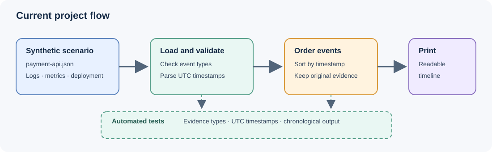
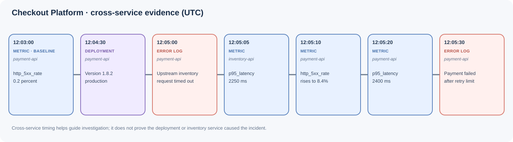

# AI SRE Copilot

An educational project for investigating incidents across an application, its services, and their supporting components. The current version loads a deterministic, synthetic application scenario and prints evidence from multiple entities in time order. It is read-only: it does not connect to production systems or change anything. It does not use an AI model or RAG yet.

## How the project works

The incident is stored as JSON so it is easy to inspect and change. Each scenario describes an application, its entities, their dependencies, and the evidence events. An entity can be a **service** such as `payment-api` or a **component** such as a database. Each event points to the entity it describes and has an ISO 8601 UTC timestamp (`Z`) plus a type: `log`, `metric`, or `deployment`.

For example, `payment-api` can declare that it depends on `inventory-api` and `orders-db`. An event with `"entity_id": "inventory-api"` then places inventory evidence in the same application timeline, so investigators can compare related signals across the dependency graph.

The timeline module checks that entities and dependencies are valid, verifies event references and timestamps, sorts all evidence together by time, and prints each record with its entity name. That makes it possible to see a symptom in one service next to a related measurement from another. Python's standard library handles this, so no service, database, or third-party package is needed.



The diagram source is editable in [diagrams.net](https://app.diagrams.net/) using [project-flow.drawio](docs/diagrams/project-flow.drawio).

## Synthetic incident walkthrough

The example application is the **Checkout Platform**. `payment-api` depends on `inventory-api` and `orders-db`; `inventory-api` depends on `inventory-db`. Around the deployment of payment version `1.8.2`, the timeline shows the payment service's 5xx rate rising from 0.2% to 8.4%, an inventory timeout, increased inventory latency, and payment latency reaching 2400 ms before a request fails after retries.



The timeline makes the cross-service sequence easy to inspect, but timing alone does not prove that the deployment caused the errors. The diagram source is editable in diagrams.net using [incident-timeline.drawio](docs/diagrams/incident-timeline.drawio).

## Project structure

- `data/incidents/payment-api.json` — a deterministic application scenario with a service dependency graph and sample logs, metrics, and deployment evidence.
- `src/ai_sre_copilot/timeline.py` — loads and validates an application scenario, sorts events across entities, and prints the timeline.
- `tests/test_timeline.py` — verifies that all evidence types are present, timestamps are UTC, and sorted output is chronological.
- `docs/diagrams/` — editable diagrams.net source files and SVG versions displayed above.

## Run

Requires Python 3.10 or later. From the repository directory:

```sh
python3 -m src.ai_sre_copilot.timeline
```

Pass another scenario file as an optional argument:

```sh
python3 -m src.ai_sre_copilot.timeline path/to/another-scenario.json
```

## Tests

```sh
python3 -m unittest discover -s tests -v
```

## Next step

Add support for collecting evidence from multiple source files into this shared scenario format, then build an analysis layer that follows dependency relationships among services and components. It should link related logs, metric changes, and deployments while showing the evidence behind each explanation. An AI model or RAG can be considered later; any explanation should remain evidence-based, and the system should stay read-only.
